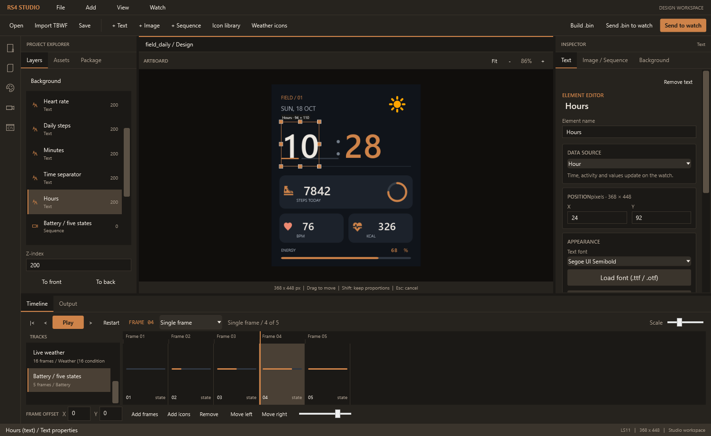
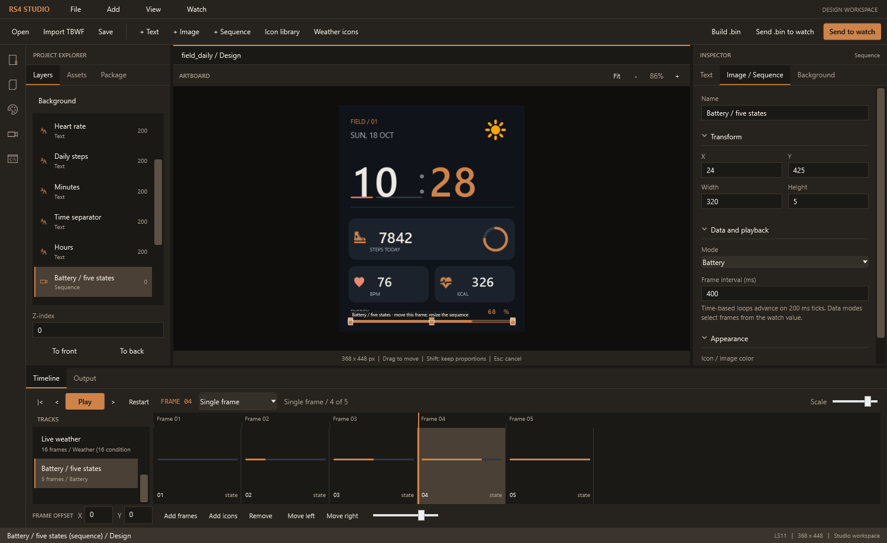
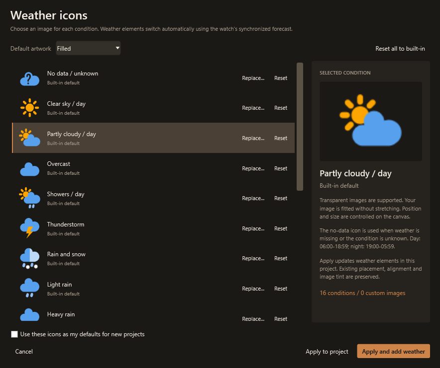
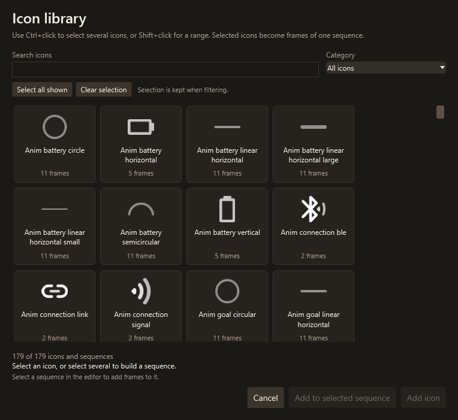

# Haylou RS4 Plus Watchface Maker

A Windows editor for creating native watchfaces for the **Haylou RS4 Plus (LS11)**. Import **TBWF designs made for the standard RS4**, edit their supported elements, or start with an empty canvas.

The **Studio workspace is the default editor**: Project Explorer on the left, an interactive canvas in the center, Inspector on the right and an animation timeline below.

> Experimental community project. Local package checks and ARM emulation help detect known problems but do not guarantee stability for every firmware or design. See [validation limits](docs/testing.md) and [troubleshooting](docs/troubleshooting.md).

## Get started

1. Follow the [installation guide](docs/installation.md) to configure Python, .NET and the ARM toolchain.
2. Launch the Release editor and [create or import a design](docs/editor-guide.md#getting-started).
3. Save the editable project and generate its native `.bin` file.
4. [Send it to the watch](docs/uploading.md), or choose **Send .bin to watch** for an existing export.

## Features

- Import standard RS4 TBWF images, supported text, custom fonts and sequences.
- Move and resize elements on a **368 x 448** canvas; manage backgrounds, layers and z-index.
- Use TTF/OTF fonts or create and edit fonts from PNG characters.
- Display time, date, activity data, battery, temperature and live weather icons.
- Inspect individual frames, play sequences and align each frame independently.
- Save editable projects, build native packages and validate them before upload.

## Compatibility

| Item | Reference |
| --- | --- |
| Watch | Haylou RS4 Plus / LS11 |
| Watch firmware | `V22.07.001.1.1.1.4.28` |
| Canvas | 368 x 448 pixels |
| Imported format | Hello Haylou `.tbwf`, including designs for the standard RS4 |
| Exported format | Native SiFli `.bin` dial package |
| Desktop | Windows, WPF / .NET 9 |

TBWF files are converted into a new LS11 package; the watch does not load TBWF directly. Unsupported elements and different proportions can need adjustments. Other watch models and firmware versions have not been established as compatible. See [importing standard RS4 designs](docs/editor-guide.md#importing-standard-rs4-tbwf-designs).

## Documentation

| Guide | Read about |
| --- | --- |
| [Installation](docs/installation.md) | Dependencies, configuration and Release build |
| [Editor guide](docs/editor-guide.md) | Workspace, backgrounds, fonts, live data, layers and animations |
| [Upload to the watch](docs/uploading.md) | Sending a project or an existing `.bin`, pairing and IDs |
| [Command-line tools](docs/cli.md) | Inspect, build, validate and convert packages |
| [Technical overview](docs/technical-overview.md) | How the watchface format and editor were developed |
| [Testing](docs/testing.md) | Regression checks, ARM emulation and validation limits |
| [Troubleshooting](docs/troubleshooting.md) | Common errors and recovery |
| [Project structure](docs/project-structure.md) | Source layout and tooling |
| [Credits](docs/credits.md) | Research references and third-party tools |

See the [documentation index](docs/README.md) for all guides and research notes.

More editor screenshots

### Animation timeline

Inspect individual frames, align images and choose live-data or loop preview.

### Built-in assets

| Weather icons | Icon library |
| --- | --- |
|  |  |

Independent community project; not affiliated with or endorsed by Haylou.
