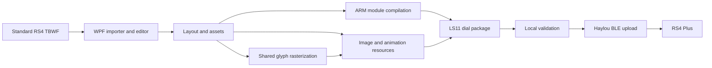

# Haylou RS4 Plus Watchface Maker

A Windows watchface editor and reverse-engineering project for the **Haylou RS4 Plus (LS11)**.

Import a **TBWF watchface made for the standard Haylou RS4**, edit its images, text, fonts and animations, and build a native `.bin` watchface for the RS4 Plus. The editor converts supported elements into a new LS11 package; the watch does not load TBWF files directly.

**Repository:** [RikzDev/Haylou-rs4-plus-watchface-maker](https://github.com/RikzDev/Haylou-rs4-plus-watchface-maker)

> **Development status:** This is an experimental project. The editor, builder and Bluetooth uploader are included; install the dependencies and configure your watch address before uploading. Earlier experimental modules caused fallback screens and, in one case, a crash requiring a factory reset. Local validation helps catch known problems, but does not establish compatibility with every firmware or watchface.

## Contents

- [Features](#features)
- [Compatibility](#compatibility)
- [Installation](#installation)
- [Studio workspace](#studio-workspace-design-branch)
- [Getting started](#getting-started)
- [Text, fonts and live data](#text-fonts-and-live-data)
- [Images and animations](#images-and-animations)
- [Sending a watchface to the watch](#sending-a-watchface-to-the-watch)
- [Command-line tools](#command-line-tools)
- [Technical information: how we built it](#technical-information-how-we-built-it)
- [Testing](#testing)
- [Troubleshooting](#troubleshooting)
- [Project structure](#project-structure)
- [References and credits](#references-and-credits)

## Features

- Import standard RS4 `.tbwf` designs, including supported images, embedded fonts and frame sequences.
- Edit a **368 × 448** watch preview with click selection, drag-and-drop movement and eight resize handles.
- Edit fixed images separately from animations and the background.
- Preview a sequence in a loop, inspect one frame, or use its data-driven behavior.
- Align individual frames with independent offsets.
- Reuse imported TTF/OTF fonts or load an external font for new text.
- Import numbers stored as separate PNG characters instead of a font.
- Adjust character size, color and spacing; PNG characters preserve their original artwork and colors.
- Display time, date, battery, steps, heart rate and weather temperature using firmware data.
- Save an editable project with its image and font assets, then generate a native LS11 `.bin` package.
- Validate package checksums, resource links and known module requirements before upload.
- With the uploader configured, generate an unsaved binary before sending and try another known custom ID when a slot is occupied.

The editor UI and tool output are in English. The Output panel uses white for information, yellow for warnings and red for errors. A blue upload note explains the expected first pairing failure and automatic retry.

## Compatibility

| Item | Support |
| --- | --- |
| Target watch | Haylou RS4 Plus, identified as LS11 in the investigated device |
| Output resolution | 368 × 448 pixels |
| Imported design format | Hello Haylou TBWF, including designs for the standard RS4 |
| Output format | SiFli `dial` container with an ARM module, resources and thumbnail |
| Desktop platform | Windows; the editor uses WPF and upload uses Windows Bluetooth APIs |
| Arbitrary watch models or firmware | Compatibility has not been established |

### Importing TBWF files from the standard RS4

**Yes: standard RS4 TBWF designs can be imported and adapted for the RS4 Plus.** The importer reads `TiBoWaFe.json`, the dial artwork and supported resource entries, then rebuilds the watchface for LS11.

This is a format conversion, so the original TBWF is not sent to the watch. Different proportions, unsupported widgets and resource naming conventions can require manual adjustments. The background is fitted to the RS4 Plus screen; check every element after import, especially designs with a different aspect ratio. A circular design does not automatically become a correctly arranged rectangular design.

## Installation

Run the commands in **PowerShell**, from the repository root unless stated otherwise.

### 1. Install the prerequisites

| Dependency | Purpose |
| --- | --- |
| Windows with a working Bluetooth adapter | Editor platform and optional PC upload |
| [.NET 9 SDK](https://dotnet.microsoft.com/download/dotnet/9.0) | Build and run the WPF editor |
| [Python 3.13](https://www.python.org/downloads/windows/) | Image processing, package generation and diagnostics |
| Git, or a downloaded source archive | Obtain the project |
| [xPack GNU Arm Embedded GCC 12.3.1-1.2](https://github.com/xpack-dev-tools/arm-none-eabi-gcc-xpack/releases/tag/v12.3.1-1.2) | Compile the watch-side module |
| `watchface/tools/ezip.exe` | Convert images into the SiFli eZip format |

Python 3.13 and .NET 9 are the development versions used by this project. Other versions have not been systematically tested.

### 2. Download the source

```powershell
git clone https://github.com/RikzDev/Haylou-rs4-plus-watchface-maker.git
Set-Location Haylou-rs4-plus-watchface-maker
```

If using a source archive, extract it and open PowerShell in that folder instead.

### 3. Set up Python

```powershell
py -3.13 -m venv .venv
.\.venv\Scripts\python.exe -m pip install -r requirements.txt
```

For optional ARM emulation and development tests:

```powershell
.\.venv\Scripts\python.exe -m pip install -r requirements-dev.txt
```

Using the virtual environment's executable directly avoids requiring a PowerShell activation-policy change.

### 4. Set up the ARM compiler and image converter

Download and extract the Windows xPack compiler. Set `HAYLOU_ARM_GCC` to the actual compiler executable:

```powershell
$env:HAYLOU_ARM_GCC = 'C:\Toolchains\xpack-arm-none-eabi-gcc-12.3.1-1.2\bin\arm-none-eabi-gcc.exe'
& $env:HAYLOU_ARM_GCC --version
```

The path above is an example. Launch the editor from this PowerShell session so it inherits the variable. To use it in later sessions, configure `HAYLOU_ARM_GCC` as a Windows user environment variable.

Without an override, the builder looks for the tested installation at:

```text
%LOCALAPPDATA%\HaylouFaceEditor\tools\armgcc\xpack-arm-none-eabi-gcc-12.3.1-1.2\bin\arm-none-eabi-gcc.exe
```

It also accepts the older `%TEMP%\armgcc` location as a fallback, but temporary folders can be cleaned by Windows or other tools.

Check the image converter:

```powershell
Test-Path .\watchface\tools\ezip.exe
```

If it is missing from your checkout, obtain it from [OpenSiFli/SiFli-SDK](https://github.com/OpenSiFli/SiFli-SDK), under `tools/png2ezip/ezip.exe`, and place it in `watchface/tools/`. Keep its [third-party notice](watchface/tools/NOTICE.txt) with the binary.

### 5. Check automatic path discovery

The editor locates `watchface/` relative to its executable or the working directory. It uses the repository's `.venv\Scripts\python.exe` when available, otherwise `python` on `PATH`. You do not need to edit source paths for a normal checkout.

For a custom installation, optional environment overrides are available:

```powershell
$env:HAYLOU_PROJECT_ROOT = 'C:\Projects\Haylou-rs4-plus-watchface-maker'
$env:HAYLOU_PYTHON = 'C:\Projects\Haylou-rs4-plus-watchface-maker\.venv\Scripts\python.exe'
```

Replace these example paths with your own. The project-root override points to the folder containing `watchface/`, not to `watchface/` itself.

### 6. Configure PC upload, if needed

**Editing and binary generation do not require a Bluetooth connection.**

The uploader is included as [`watchface/send_face2.py`](watchface/send_face2.py). Set the address of your own watch before starting the editor:

```powershell
$env:HAYLOU_WATCH_ADDRESS = 'AA:BB:CC:DD:EE:FF'
```

The value above is a placeholder, not a device to connect to. Obtain your watch's Bluetooth address using a BLE scanner. The uploader requires a configured address and does not select an arbitrary RS4 by its advertised name.

Launch the editor from the same PowerShell session, or set this as a Windows user environment variable for later launches. Upload logs are written to `watchface/send_face2.log`. The recovery helper uses the same address and is not part of normal installation.

### 7. Build and launch

```powershell
dotnet build .\editor\HaylouFaceEditor.csproj
dotnet run --project .\editor\HaylouFaceEditor.csproj
```

After building, the executable is normally available at:

```text
editor\bin\Debug\net9.0-windows\HaylouFaceEditor.exe
```

## Studio workspace (design branch)

The `design/studio-workspace` branch introduces an IDE-style editor with the existing warm dark palette. The visual plan is in [Studio workspace design](docs/design/studio-workspace.md).

- Use **Project Explorer** on the left for layers, image/sequence assets and package settings.
- Select an element in the explorer or canvas to open its **Inspector** on the right. Text, image/sequence and background properties have separate tabs.
- Resize the panes with the vertical and horizontal splitters. **View > Reset panel layout** restores the defaults.
- Use **Fit**, the zoom buttons or **Ctrl+mouse wheel** over the artboard; zoom does not change exported coordinates.
- The bottom **Timeline** provides a track picker, frame filmstrip, ruler/playhead, transport and frame offsets. Click a frame or drag on the ruler to pause and inspect one frame. Drag a frame thumbnail to reorder it, preserving its original artwork and offsets. Use the scale slider to change the filmstrip width; long sequences scroll horizontally and follow a newly selected or playing frame.
- **Live data** follows the existing watch-value mapping. **Play loop** inspects artwork as a timed sequence. Data-driven frames are labeled as states; loop inspection does not change their exported data source.
- **Space** plays/pauses and **Left/Right**, **Home/End** select frames when focus is outside a text field or other value editor. **Ctrl+O**, **Ctrl+I**, **Ctrl+S** and **Ctrl+Shift+B** open, import, save and build.
- **Output** is a separate bottom tab with the existing severity colors. Build and upload operations display their output and disable editing while running.

Existing projects and the native watchface format remain compatible.

## Getting started

1. Launch the editor. It starts with an empty 368x448 black canvas and no elements.
2. Add text, images, sequences or built-in icons, or choose **Import TBWF** to start from a standard RS4 design.
3. Check the background, text, fixed images and frame sequences in the preview.
4. Click an element to select it. Drag to move it, or use its handles to resize it.
5. Assign each text element its intended data source and font.
6. Save an editable `.hface.json` project.
7. Choose **Generate .bin** and select an output file.
8. Review the build log before attempting an upload.

**Shift** preserves image proportions during resizing. Text and clock hands preserve their proportions automatically. **Escape** cancels the current drag or resize. A click by itself does not move an element.

Importing a TBWF is optional. You can save and reopen a project created from scratch, generate a `.bin` and use **Send to watch** directly. Faces containing only images or animations, and even an empty background, are supported. You can also remove the final text element.

Keep the project JSON and its companion assets together. Saving a project can create a background PNG and sibling `-fonts`, `-characters` and `-frames` folders. The `.bin` is the generated watch package; it does not replace the editable project.

## Background image

Use the **Background** panel below the main buttons to change the canvas independently of text, images and animations:

- **Change image...** loads a PNG, JPEG or BMP. **Remove image** keeps the fill color.
- **Fill color** accepts `#RRGGBB` and appears around the image and through transparent pixels.
- **Image fit** offers **Fill screen (crop)**, **Fit whole image**, **Stretch to screen** and **Original size**.
- **Zoom** scales the image from 10% to 400%. **X offset** and **Y offset** move it relative to its centered position.
- **Reset placement** restores centered, 100% fill-screen placement.

The preview updates immediately. The background remains below all elements. Saving preserves the original image in a companion `-background.png` file along with the fit, color, zoom and position, so you can adjust the crop again after reopening. The generated watch package uses the same rendered 368x448 background as the editor. Existing projects and TBWF backgrounds can also be edited.

## Text, fonts and live data

Select a text element and choose its data source:

| Data source | Behavior |
| --- | --- |
| Fixed text | Displays the text you enter |
| Hour, minute, second | Uses the watch's clock |
| Month, day, weekday | Uses the watch's date; the text weekday source is numeric |
| Year | Shows the full four-digit year from the watch, for example `2026` |
| Steps | Uses the decoded activity information |
| Heart rate | Shows the available heart-rate reading, otherwise `--` |
| Battery | Shows the numeric battery percentage |
| Temperature / weather | Selects today's synchronized forecast; uses the watch's Celsius/Fahrenheit setting, otherwise `--` |
| Calories (kcal) | Uses the decoded milli-kcal field, divided by 1000 |
| Distance (km/mi) | Shows two decimals and follows the watch's unit setting |
| Distance (whole km/mi) | Digits only, discarding decimals: `7.50` becomes `7`; follows the same unit setting |
| Distance unit (km/mi) | Shows `km` or `mi` for the current unit setting |
| AM/PM (12h mode) | Shows `AM` before noon and `PM` from noon; blank in 24-hour mode |

The old division-by-1000 option has been removed from the text and animation menus. Older projects using it load as **Calories (kcal)**; legacy distance elements load as **Distance (km/mi)**. The builder retains the old `scaled` key for compatibility with external layouts.

Distance uses its own decoded field rather than the old generic scaled value. TBWF `calorie` and `distance` elements now import with the correct sources. Older saved distance elements using the generic source are updated on open. See [activity and AM/PM analysis](watchface/activity_time_analysis.md) for the official-dial evidence and validation scope.

The preview sample is a design aid. It does not replace the live value used on the watch.

### Choosing a font

Use the font selector to reuse an embedded TBWF font in a new text element. Use **Load font** to add a `.ttf` or `.otf` file. Imported PNG character sets are also listed and can be reused for elements whose required characters are available.

To create an image font from separate PNGs:

1. Select a text element and click **Load PNG font...** in its font controls.
2. Select the character PNGs. The mapping window shows a thumbnail, filename and editable character for every image.
3. Check that each image maps to the correct character. Ten numbered images can be assigned to `0–9` automatically in numeric filename order; **Assign 0–9 in this order** can also apply that mapping. Duplicate or unsupported characters must be corrected before using the font.
4. Give the font a name and check the preview, then click **Use font**. Choose a numeric data source such as Hour, Minute, Battery or Steps, or enter fixed text containing the mapped characters.
5. Adjust size and character spacing in the text editor. The font appears in the font chooser and can be reused in other text elements.

**Save font...** creates a reusable `.hfont.json` file and a companion image folder. Keep them together. Open the `.hfont.json` through **Load PNG font...** to load that mapping directly. Saved projects also preserve loaded PNG fonts, including fonts that are not currently assigned to a text element. Original PNG colors and transparency are retained; this creates an image font rather than a TTF/OTF font.

### Editing a PNG font

1. Select a text element that uses the PNG font, then click **Edit PNG font...** below **Load PNG font...**.
2. Use **Add images** to include more letters, digits or punctuation. Check or change the character assigned to each image.
3. Select a row and choose **Replace image...** to change its artwork while keeping its character. **Remove selected** deletes character mappings from the font.
4. Edit the font name and preview text, then choose **Apply changes**. All text elements using that font update together, retaining their individual size, spacing, color, layer and position.

**Cancel** leaves the loaded font unchanged. **Save font...** exports a reusable `.hfont.json`; save the project to preserve the edited font with the face. Duplicate character assignments are rejected, and missing characters needed by existing text are reported in Output. Loaded font definitions support up to 95 printable ASCII characters (letters, digits and punctuation). The existing export limit remains 40 distinct requested characters per raster font set; unused catalogue characters are not packed.

Change **Character spacing** to adjust the distance between characters: positive values separate them, negative values bring them closer. The preview and exporter use the same raster cells and spacing.

Fixed text is currently limited to **12 characters**. The glyph runtime does not implement general Unicode text shaping, so complex scripts and arbitrary Unicode text are not established as supported. PNG character maps require explicit single-character ASCII mappings.

The battery source displays the number only: add a separate fixed `%` text if desired. Temperature likewise provides the numeric value; unit artwork can be a separate element. Weather must first be synchronized to the watch by the phone app.

## Images and animations

### Layers and z-index

Use the **Layers** panel to choose any text, image, sequence or clock hand, including an element hidden behind another one. The list runs from front to back. Enter its **Z-index** to set the drawing priority: higher numbers appear in front; negative values are supported. **Bring to front** and **Send to back** place the selected element at either end of the stack.

The preview and exported ARM module use the same stable layer order. All characters of a text element and all frames of a sequence stay together in their element's layer. Equal indices follow the existing collection order; the later element appears in front. The background stays behind the editable elements.

Layer values are saved with the project. Older projects retain the previous preview defaults: images/sequences at 0, hands at 100 and text at 200.

### Fixed images

Add or select a fixed image to move and resize it independently. It uses the same positioning controls as a sequence, with its mode set to **Fixed image**. The dial background remains the fitted background layer.

### Built-in TBWF icons

Some TBWF files refer to Hello Haylou icons by name (for example `stepResource_ic_wf_step_shoe_print.png`) without storing the image inside the archive. Their website preview can show a heart, shoe or weather icon even though the TBWF contains no matching PNG.

The editor now includes the extracted icon definitions as embedded resources. **You do not need to load an APK or populate a cache.** Supported references are resolved automatically when importing a TBWF. Click **Icon library** to browse thumbnails, search by name, filter by category and add a fixed icon or a complete sequence to your design. The gallery currently contains 179 supported entries; two Android layer-list circle effects remain unsupported.

Vector icons and animation lists are converted into editable PNG frames with the imported position, size and solid color. Transparent fills, strokes and trimmed progress paths are supported. Invisible resources remain hidden, and images embedded in the TBWF take priority over library resources. Unsupported drawable types produce a warning instead of silently disappearing.

Select an icon or image in **Image sequences**, then use **Icon / image color**. Choose a palette swatch or enter `#RRGGBB`; `#AARRGGBB` also controls opacity. The chosen color applies to every frame, updates the preview and is written into the PNGs exported to the watch. Click **Original** to restore the source artwork. Original frames and the selected color are saved with the project, so you can change or restore the color after reopening it without accumulating opacity changes. This also works with older saved projects and ordinary imported images.

Battery resources use battery-driven selection. Raw TBWF/library weather and Bluetooth connection sets are imported with all their frames in **Fixed image** mode. Use **Weather icons** for live weather with the validated native condition order; automatic Bluetooth connection selection remains unsupported. Use **Single frame** to inspect them or reorder the desired image to the first position for a fixed display. Imported PNGs are saved with the project, so reopening it and generating a `.bin` no longer require the APK.

### Live weather icons and personal defaults

Click **Weather icons** in the toolbar or **Add > Weather icons**. Choose **Filled** or **Outline** artwork, then **Apply and add weather** to create a live weather element. The watch selects today's synchronized forecast and switches between day and night variants for clear sky, partly cloudy sky and showers. Day is 06:00-18:59; night is 19:00-05:59. Missing forecasts and unknown condition codes use **No data / unknown**.

Use **Replace...** beside any condition to load a PNG, JPG or BMP. Transparent PNGs are supported; images are fitted without stretching. **Reset** restores one icon, and **Reset all to built-in** restores the whole set. **Apply to project** updates existing weather elements while preserving placement, size, z-index, frame offsets and tint. Use **Original** in the image inspector if you want the replacement's original colors instead of an existing tint.

Check **Use these icons as my defaults for new projects** to store your set locally. Each saved project keeps its own settings and custom images in a companion `*-weather` folder. Copy that folder together with the project and its other asset folders. Preferences are stored under `%LOCALAPPDATA%/HaylouFaceEditor/weather-icons/`.

Weather has 16 fixed condition slots. Use **Single frame** or timeline scrubbing to inspect them; add, remove and reorder are disabled to preserve the firmware mapping. An arbitrary 18-frame TBWF weather sequence uses a different order and is not converted automatically. The live editor preview shows clear daytime weather; the watch uses its actual synchronized data. See the [native mapping and validation](watchface/weather_icons_analysis.md).

### Text element names

Select a text element and edit **Element name** in the text inspector. The name is saved with the project and shown in Layers. It is independent of the rendered text, selected data source and font; use the text content field to change what the watch displays.

### Progress sequences: heart rate, steps, calories and distance

Choose **Heart rate**, **Steps**, **Calories (whole kcal)** or **Distance (whole km/mi)** for images that become progressively more filled as the measured value increases. Set **Minimum** and **Maximum** to define the visual range. Arrange frames from least filled to most filled.

| Mode | Default range | Unit | Highest configurable maximum |
| --- | --- | --- | --- |
| Heart rate | 0-200 | BPM | 255 |
| Steps | 0-10000 | Steps | 99999 |
| Calories (whole kcal) | 0-1000 | Whole kcal | 99999 |
| Distance (whole km/mi) | 0-10 | Whole km or mi, following the watch's unit setting | 99999 |
| Battery | 0-100, fixed | Percent | 100, fixed |

Enter whole numbers with `0 <= minimum < maximum`. Frames divide this inclusive range into equal buckets. With five heart-rate frames and the default range, the buckets are **0-40**, **41-80**, **81-120**, **121-160** and **161-200 BPM**. With five steps frames and a 0-10000 range, they are **0-2000**, **2001-4000**, **4001-6000**, **6001-8000** and **8001-10000 steps**. Values below or above the configured range stay on the first or last frame, so reaching a goal never loops back to an empty bar. An unavailable heart-rate reading selects the first frame. A single frame remains fixed; sequences support up to 64 frames.

**Live data** previews this mapping at sample values: **72 BPM**, **1234 steps**, **300 kcal** and **7 whole km/mi**. **Play loop** and **Single frame** inspect the artwork independently of the live selector. Choosing another mode resets the range to that mode's defaults. Ranges are saved with the project and included in the generated binary. Older projects without saved ranges use the defaults above. Regenerate and upload the `.bin` to update an existing watchface. Use **Continuous loop** for a repeating animation independent of measured data. Time and calendar sequences keep their existing cyclic selection.

### Frame sequences

To build a sequence from separate library icons:

1. Open **Icon library**, then search for a family such as `progress circular`.
2. Use **Ctrl+click** to select individual icons, **Shift+click** for a range, or **Select all shown** for the filtered group. Selection is kept when changing filters; **Clear selection** resets it.
3. Click **Create sequence**. Selected icons are combined into one sequence, in library order; numbered states are sorted numerically, such as 0, 10, 20 through 100. Selecting an existing library animation includes all its frames.
4. In the side panel, choose **Continuous loop** for a timed animation, or a data-driven mode such as **Battery**, **Second** or **Weekday**. Set the interval for timed loops and use **Play loop** or **Single frame** to inspect the result.

To extend an existing sequence, select it first, click **Add icons as frames...**, choose icons and click **Add to selected sequence**. New frames are inserted after the selected frame, or at the end when no frame is selected. They fit inside the sequence dimensions without stretching the icon, inherit its selected color, and preserve its position, mode, interval and existing frame offsets. Use the frame reorder buttons to adjust the order afterward.

The gallery shows the number of resulting frames and enforces the 64-frame limit for both new and existing sequences. A combined sequence normally starts as a continuous loop; a selection consisting only of battery resources uses battery mode.

Select a sequence to add, remove or reorder its frames. Choose a preview mode:

- **Live/data preview:** follows the sequence's configured mode using preview values.
- **Loop preview:** plays all frames so you can inspect the entire sequence.
- **Single frame:** displays one selected frame for alignment.

In single-frame mode, dragging adjusts **only that frame's offset**. Resizing changes the common dimensions of the sequence. Playback pauses during an active drag or resize.

Supported sequence modes include continuous loop, battery, weekday, day of month, month, second, minute, 12-hour clock, steps, calories, distance, AM/PM, heart rate. A battery sequence selects its first frame at 0% and its last frame at 100%, distributing intermediate values across the sequence. Other data-driven modes use their implemented index mapping; check that your frame order matches the intended values.

**AM/PM** sequences require exactly two frames: AM first, PM second. They follow the watch's 12-hour setting and are hidden in 24-hour mode. AM/PM can also be added as ordinary dynamic text, using a TTF/OTF font or PNG characters for A, P and M.

The current builder permits up to **64 frames per sequence**, with frame dimensions no larger than **368 × 448**, and an interval from **200 to 10,000 ms**. These limits do not guarantee that every large combination fits the watch's available resources.

## Sending a watchface to the watch

This workflow requires the uploader configuration described in [Installation](#installation).

1. Generate the face and check the build log.
2. Turn off Bluetooth on the phone temporarily so it releases the watch connection.
3. Keep the watch near the PC and choose **Send to watch**.
4. If the binary has not been generated or has become outdated, the editor asks for an output path and builds it before sending.
5. Accept a pairing request on the watch if one appears.
6. Wait for the installation result, then check the actual watch display.
7. Re-enable phone Bluetooth after the PC disconnects.

To install an existing export, choose **Send .bin to watch** in the toolbar or **Watch > Send .bin to watch...**, then select the file. This action reads the ID from the selected package and uploads it without building, saving or changing the open project. The uploader validates the package before connecting; invalid or incompatible exports are rejected. The original selected file is preserved; collision recovery may save a separate copy with another ID.

Uploads from the open project start with ID **253**; direct binary uploads start with the ID stored in that file. If that slot is occupied, it can try the other known custom IDs **251, 252 and 260** while preserving installed faces. These IDs were used in this project's experiments; they are not a universal reserved range. If every candidate is occupied, the uploader stops. It does not delete a working face automatically.

The first Windows pairing attempt may fail and disconnect, followed by a successful encryption-only reconnection. The reconnect pause is 0.5 seconds; an already dropped link does not receive a redundant disconnect request. Bluetooth discovery, Windows pairing and connection setup may still take longer. A completed chunk transfer is not by itself proof of installation: the uploader also waits for the watch to report the intended dial ID.

## Command-line tools

Use the virtual environment's Python executable in the following examples.

### Inspect or unpack a native package

```powershell
.\.venv\Scripts\python.exe .\watchface\rs4face.py info .\watchface\out\my_face.bin
.\.venv\Scripts\python.exe .\watchface\rs4face.py unpack .\watchface\out\my_face.bin .\unpacked --png
```

### Build a live watchface from a layout

The editor generates a layout internally. Developers can supply their own JSON containing `widgets` and optional `hands` and `animations`:

```powershell
.\.venv\Scripts\python.exe .\watchface\build_live.py `
    --png .\background.png `
    --layout .\layout.json `
    --id 253 `
    --name my_face `
    --title "My Face" `
    --output .\watchface\out\my_face.bin
```

The background must be 368 × 448. The package name must contain 1–15 UTF-8 bytes. Exported raster text is limited to a total of 64 glyph slots per face.

### Validate without connecting

The uploader's `--check` option performs package validation without a Bluetooth connection or configured watch address:

```powershell
.\.venv\Scripts\python.exe .\watchface\send_face2.py .\watchface\out\my_face.bin 253 --check
```

To send from the command line, configure `HAYLOU_WATCH_ADDRESS`, release the phone's Bluetooth connection, and run the same command without `--check`.

### Photo-only conversion

`rs4face.py create` and `rs4face.py tbwf` belong to the simpler **photo-face** path. They replace the background while the firmware draws its own fixed clock. Use the editor or `build_live.py` for editable live elements and animations.

## Technical information: how we built it

The project grew from comparing official downloads, inspecting the phone applications and measuring the actual Bluetooth transfer. The aim was to reproduce the watch's existing installation and rendering interfaces.



### 1. Obtain real watchface files

We examined the official app's assets and downloaded watchfaces, then monitored the Android Haylou Fun cache to retrieve native packages as they appeared. This provided actual files accepted by the watch, including faces containing activity widgets, image sequences and weather.

The cache-monitoring helper is [`watchface/monitor_haylou_cache.ps1`](watchface/monitor_haylou_cache.ps1). It uses ADB and watches the app's external cache, saving newly observed dial files into `incoming/`. Android permissions and storage restrictions vary; ADB/cache access is a research tool, not a requirement for normal editing. It uses the repository's Python environment, with an optional `HAYLOU_PYTHON` override.

### 2. Separate photo faces from executable watchfaces

The first important finding was that a photo face could replace the background but could not move the firmware's built-in clock. A fully editable face required the executable package format used by official dials.

We identified a container with the four-byte magic **`dial`**, version **`0x0701`** in the investigated files, an ID, a file-entry table and CRC-16 checksums. A typical live package contains:

| Member | Purpose |
| --- | --- |
| `dial_<id>.dsc` | Descriptor identifying the package members |
| `dial_<id>.so` | ARM code that creates and updates the face |
| `dial_<id>_res.so` | Image descriptors and pixel resources |
| `dial_<id>_tn.bin` | Thumbnail, typically 260 × 317 |

[`rs4face.py`](watchface/rs4face.py) implements container inspection, packing and checksum verification. The container checksums and Bluetooth framing checksums are separate concerns.

### 3. Reconstruct the watch-side module interface

Official modules revealed an ARM Thumb, Cortex-M33 hard-float target and firmware-provided LVGL/RT-Thread interfaces. We studied exported entry points, imported symbols, lifecycle callbacks, resource descriptors and relocations.

The custom module registers its initialization, pause, resume and deinitialization callbacks with `app_clock_register`. It uses the firmware's clock and activity APIs, creates LVGL image objects and updates their sources as values change. The build uses a data-only firmware import table to avoid unsupported compiler-generated PLT relocations.

### 4. Reproduce the resource layout

Images are converted to RGB565 eZip resources with the SiFli converter. Resource descriptors point at pixels in `.ROM3_IMG.*` sections of the resource module. We also reconstructed the built-in resource-manager setup and the required language-pack export; valid-looking pixels alone were insufficient for reliable module initialization.

Clock hands use uncompressed RGB565 with alpha because rotating compressed eZip images caused failures during development. Their dimensions, position and pivot are exported together.

### 5. Implement text, live values and animations

Official animated faces showed both animation-player calls and ordinary image swapping. Battery indicators could be data-selected images rather than a time-based animation. The editor's runtime uses frame-source changes and separate index rules for loops and data-driven sequences.

Custom fonts are rasterized into image glyphs. This avoids the investigated firmware's restrictions on system-font sizing and preserves the requested appearance. Separate digit PNGs use the same live glyph-selection path. Preview generation and package generation now share rasterization, cell dimensions and numeric padding, correcting discrepancies from the earlier native WPF text preview.

For temperature, official faces 77 and 100 revealed `apph_cfg_weather_info_get`, seven forecast records with a 48-byte stride, signed Celsius at offset `+8`, and a UTC timestamp at `+12`. The module selects today's local date and converts to Fahrenheit when the firmware's unit setting requests it. It caches the result by date and hour and uses a conservative 384-byte heap destination. The full proprietary output structure remains incompletely decoded. See the [weather analysis](watchface/weather_face77_analysis.md).

### 6. Reconstruct the Bluetooth upload

Phone Bluetooth HCI captures and app analysis established the Haylou transfer sequence. The working implementation announces the watchface with command **34**, sends command **32** data in **4096-byte chunks**, and divides framed writes into the observed **495-byte ATT slices** when the negotiated link permits them.

A serial confirmation exchange follows each chunk response. Command **82** reports the installed/active dial; it is not treated as a verified face-selection command. Timing, acknowledgment handling and pairing behavior mattered as much as the file bytes. Reusing acknowledgments or confusing the transfer chunk size with the ATT slice size led to repeated synchronization failures.

Custom-ID changes update the container, descriptor paths, ELF identities and checksums together. ID **254** belongs to the investigated firmware's photo-face path and is excluded from the live-module slot pool.

### 7. Investigate fallback and runtime crashes

Some early packages transferred successfully but fell back or crashed afterward. We investigated missing resource exports, initialization requirements, unsupported relocations, occupied IDs and firmware output-buffer sizes.

One crash investigation found that the activity getter could write beyond our original 16-byte structure. Comparing an official caller and using ARM emulation demonstrated how a larger write could overwrite saved registers. The module now reserves 64 bytes for activity output and 8 bytes for heart-rate/SpO2 output, with bounds suitable for the decoded fields and conservative extra space. Preflight rejects known older editor module revisions.

### 8. Distinguish implementation from device validation

A simple rebuilt face with a custom font was confirmed working on the watch during development. More complex combinations, the shared raster preview and the temperature implementation have local build, integrity and mocked-runtime checks; those checks do not run the real watch image decoder or prove stability on every firmware.

The [reverse-engineering notes](docs/reverse-engineering.md) summarize the investigation and the verified transfer settings. Raw phone captures, app binaries and development-session logs are kept outside this repository.

## Testing

Run the suite from the repository root:

```powershell
.\.venv\Scripts\python.exe -m unittest discover -s watchface -p 'test_*.py' -v
```

ARM compilation checks require the compiler. Runtime checks additionally require Unicorn; unavailable dependencies cause the relevant tests to be skipped. The latest verification of the published source ran **44 tests**, including:

- Required resource and language-pack exports, plus rejection of known older modules.
- Package retargeting and occupied-slot handling without automatic deletion.
- PNG character mappings, artwork preservation and resized hand pixels.
- Preview/export agreement on glyph pixels, spacing, coordinates and element z-index.
- Year, calories, whole/fractional distance, km/mi, AM/PM and 12/24-hour transitions.
- Configurable progress sequences, unavailable heart-rate readings, goal crossings, large values and independent frame offsets.
- Weather date selection, signed values, Fahrenheit conversion, cache refresh, missing data and allocation boundaries with mocked firmware calls.

To exercise a generated module without Bluetooth:

```powershell
.\.venv\Scripts\python.exe .\watchface\emulate_module.py .\watchface\out\my_face.bin `
    --today-size 64 --heart-size 8 --iterations 500 --initialize
```

These are simulated firmware services with explicit output sizes. They help detect memory and resource-access errors, but do not reproduce the complete firmware.

## Troubleshooting

| Symptom | What to check |
| --- | --- |
| The editor cannot build or open | Confirm the .NET 9 SDK and rebuild the WPF project |
| Missing Python, compiler or image-converter error | Check `.venv`, optional `HAYLOU_PYTHON`/`HAYLOU_PROJECT_ROOT` overrides, `HAYLOU_ARM_GCC` and `watchface/tools/ezip.exe` |
| Upload script not found | Keep `watchface/send_face2.py` beside the builder and its helper modules |
| Watch address is not configured | Set `HAYLOU_WATCH_ADDRESS` before launching the editor; validation with `--check` does not need it |
| Watch not found or connection drops | Release the phone's Bluetooth connection, check the adapter and configured watch address, and keep the watch nearby |
| Pairing error followed by reconnection | The investigated Windows setup sometimes needs a second encryption-only attempt; inspect the final result |
| Occupied dial ID | Let the uploader try its known alternatives; if all are occupied, remove a face through the watch/app before trying again |
| Transfer completes but the wrong face remains | Check the final reported dial ID; chunk acknowledgments alone do not confirm installation |
| TBWF elements are missing or misplaced | Review visibility, supported sources, resource mappings, frame offsets and source aspect ratio |
| No `%` or temperature unit symbol | Add a separate text/image element; these sources provide numeric values |
| Temperature shows `--` | Synchronize weather from the phone and verify the watch date; no forecast for today is treated as unavailable |
| Preview succeeds but the watch falls back or crashes | Keep the generated binary and log, note the firmware and imported design, and investigate before retrying the same package |

The **Recovery** action is a factory reset. It removes watchfaces, pairing and settings, and is intended for recovery rather than routine installation.

## Project structure

```text
editor/                       Windows WPF application
  MainWindow.xaml             Main interface
  MainWindow.xaml.cs          Import, project persistence, build and send actions
  CanvasEditing.cs            Selection, movement and resize gestures
  FontEditing.cs              Imported/external font selection
  PngFonts.cs                 PNG font registration, editing and shared mappings
  PngFontWindow.xaml          PNG character mapping editor
  BackgroundEditing.cs        Background image placement, color and persistence
  Layers.cs                   Element z-index and layer selection
  IconLibrary.cs              Built-in icon gallery and sequence creation
  ImageColor.cs               Reversible image and sequence tinting
  Assets/TbwfIcons/           Bundled drawable definitions and attribution
  GlyphPreview.cs             Asynchronous raster preview
  ProjectPaths.cs             Repository and Python path discovery
watchface/
  build_live.py               Native live-watchface builder and validation
  preview_layout.py           Preview using the exporter's glyph rasters
  rs4face.py                  Dial-container and photo-face tools
  upload_slots.py             Occupied custom-ID handling
  send_face2.py               Bluetooth uploader and preflight entry point
  emulate_module.py           Optional ARM/firmware-mock diagnostics
  module/clock.c              Watch-side rendering and live data
  module/imports.c            Firmware import table
  tools/                      eZip converter and third-party notice
  test_*.py                   Regression tests
  monitor_haylou_cache.ps1     Optional Android cache capture helper
  weather_face77_analysis.md  Official weather-face analysis
  activity_time_analysis.md   Activity fields, AM/PM and progress frame rules
  official_icon_analysis.md   Official image-resource and icon findings
  factory_reset.py            Development recovery helper
  out/                        Generated local artifacts
docs/reverse-engineering.md    Research notes without raw device/session data
requirements.txt              Runtime Python dependencies
requirements-dev.txt          Optional emulation dependency
```

`incoming/`, generated binaries, phone captures and third-party designs are local research/output artifacts and are excluded from version control.

## References and credits

- **[XorTroll/ls02-re](https://github.com/XorTroll/ls02-re)** — Reference for the documentation's separation of reverse-engineering notes, reusable implementation and desktop tooling. Its [technical notes](https://github.com/XorTroll/ls02-re/blob/main/RE.md) investigate the **Haylou Smart Watch 2 / LS02**. This project targets **RS4 Plus / LS11**, so LS02 command layouts are not assumed to apply here. This README uses the project as an organizational and research reference, without copying its protocol implementation.
- **[OpenSiFli/SiFli-SDK](https://github.com/OpenSiFli/SiFli-SDK)** — Source of the unchanged eZip converter used for image resources; see [NOTICE.txt](watchface/tools/NOTICE.txt).
- **[xPack GNU Arm Embedded GCC](https://github.com/xpack-dev-tools/arm-none-eabi-gcc-xpack)** — Compiler distribution used for the watch-side ARM module.
- **Hello Haylou and community watchface creators** — TBWF designs and resource conventions used to investigate and test import behavior. Original designs and fonts remain the work of their respective authors.

This is an independent community project, with no affiliation with or endorsement by Haylou.
