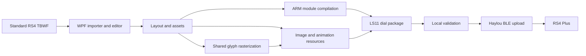

# Technical overview: how we built watchfaces

[Project overview](../README.md) | [Documentation index](README.md)

The project grew from comparing official downloads, inspecting the phone applications and measuring the actual Bluetooth transfer. The aim was to reproduce the watch's existing installation and rendering interfaces.

### 1. Obtain real watchface files

We examined the official app's assets and downloaded watchfaces, then monitored the Android Haylou Fun cache to retrieve native packages as they appeared. This provided actual files accepted by the watch, including faces containing activity widgets, image sequences and weather.

The cache-monitoring helper is [`watchface/monitor_haylou_cache.ps1`](../watchface/monitor_haylou_cache.ps1). It uses ADB and watches the app's external cache, saving newly observed dial files into `incoming/`. Android permissions and storage restrictions vary; ADB/cache access is a research tool, not a requirement for normal editing. It uses the repository's Python environment, with an optional `HAYLOU_PYTHON` override.

### 2. Separate photo faces from executable watchfaces

The first important finding was that a photo face could replace the background but could not move the firmware's built-in clock. A fully editable face required the executable package format used by official dials.

We identified a container with the four-byte magic **`dial`**, version **`0x0701`** in the investigated files, an ID, a file-entry table and CRC-16 checksums. A typical live package contains:

| Member | Purpose |
| --- | --- |
| `dial_<id>.dsc` | Descriptor identifying the package members |
| `dial_<id>.so` | ARM code that creates and updates the face |
| `dial_<id>_res.so` | Image descriptors and pixel resources |
| `dial_<id>_tn.bin` | Thumbnail, typically 260 × 317 |

[`rs4face.py`](../watchface/rs4face.py) implements container inspection, packing and checksum verification. The container checksums and Bluetooth framing checksums are separate concerns.

### 3. Reconstruct the watch-side module interface

Official modules revealed an ARM Thumb, Cortex-M33 hard-float target and firmware-provided LVGL/RT-Thread interfaces. We studied exported entry points, imported symbols, lifecycle callbacks, resource descriptors and relocations.

The custom module registers its initialization, pause, resume and deinitialization callbacks with `app_clock_register`. It uses the firmware's clock and activity APIs, creates LVGL image objects and updates their sources as values change. The build uses a data-only firmware import table to avoid unsupported compiler-generated PLT relocations.

### 4. Reproduce the resource layout

Images are converted to RGB565 eZip resources with the SiFli converter. Resource descriptors point at pixels in `.ROM3_IMG.*` sections of the resource module. We also reconstructed the built-in resource-manager setup and the required language-pack export; valid-looking pixels alone were insufficient for reliable module initialization.

Clock hands use uncompressed RGB565 with alpha because rotating compressed eZip images caused failures during development. Their dimensions, position and pivot are exported together.

### 5. Implement text, live values and animations

Official animated faces showed both animation-player calls and ordinary image swapping. Battery indicators could be data-selected images rather than a time-based animation. The editor's runtime uses frame-source changes and separate index rules for loops and data-driven sequences.

Custom fonts are rasterized into image glyphs. This avoids the investigated firmware's restrictions on system-font sizing and preserves the requested appearance. Separate digit PNGs use the same live glyph-selection path. Preview generation and package generation now share rasterization, cell dimensions and numeric padding, correcting discrepancies from the earlier native WPF text preview.

For temperature, official faces 77 and 100 revealed `apph_cfg_weather_info_get`, seven forecast records with a 48-byte stride, signed Celsius at offset `+8`, and a UTC timestamp at `+12`. The module selects today's local date and converts to Fahrenheit when the firmware's unit setting requests it. It caches the result by date and hour and uses a conservative 384-byte heap destination. The full proprietary output structure remains incompletely decoded. See the [weather analysis](../watchface/weather_face77_analysis.md).

### 6. Reconstruct the Bluetooth upload

Phone Bluetooth HCI captures and app analysis established the Haylou transfer sequence. The working implementation announces the watchface with command **34**, sends command **32** data in **4096-byte chunks**, and divides framed writes into the observed **495-byte ATT slices** when the negotiated link permits them.

A serial confirmation exchange follows each chunk response. Command **82** reports the installed/active dial; it is not treated as a verified face-selection command. Timing, acknowledgment handling and pairing behavior mattered as much as the file bytes. Reusing acknowledgments or confusing the transfer chunk size with the ATT slice size led to repeated synchronization failures.

Custom-ID changes update the container, descriptor paths, ELF identities and checksums together. ID **254** belongs to the investigated firmware's photo-face path and is excluded from the live-module slot pool.

### 7. Investigate fallback and runtime crashes

Some early packages transferred successfully but fell back or crashed afterward. We investigated missing resource exports, initialization requirements, unsupported relocations, occupied IDs and firmware output-buffer sizes.

One crash investigation found that the activity getter could write beyond our original 16-byte structure. Comparing an official caller and using ARM emulation demonstrated how a larger write could overwrite saved registers. The module now reserves 64 bytes for activity output and 8 bytes for heart-rate/SpO2 output, with bounds suitable for the decoded fields and conservative extra space. Preflight rejects known older editor module revisions.

### 8. Distinguish implementation from device validation

A simple rebuilt face with a custom font was confirmed working on the watch during development. More complex combinations, the shared raster preview and the temperature implementation have local build, integrity and mocked-runtime checks; those checks do not run the real watch image decoder or prove stability on every firmware.

The [reverse-engineering notes](reverse-engineering.md) summarize the investigation and the verified transfer settings. Raw phone captures, app binaries and development-session logs are kept outside this repository.

For the decoded live condition-to-icon mapping and its day/night boundaries, see [weather icons](../watchface/weather_icons_analysis.md).
